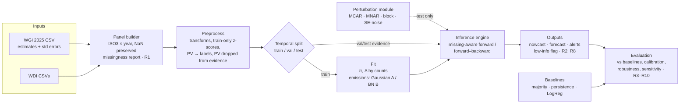

# IPR1 Proposal — Governance Instability Predictor
 
**Team:** Michael Hoefler, Colin Railey, Mercedes Rothrock  **Course:** AI380  **Date:** 24 November 2026
**Techniques:** Hidden Markov Models (HMM), Bayesian Networks (BN)
 
---
 
## 1. Problem Definition
 
### 1.1 Problem statement
Given yearly economic, political, and social indicators for a country, estimate the probability that it is in a **Stable**, **Fragile**, or **Unstable** governance condition this year and next year. Then measure how much those estimates get worse when indicators are missing or unreliable.
 
### 1.2 Stakeholder and need
**Primary users:** analysts on country-risk or early-warning teams, such as those at development banks, humanitarian NGOs, foreign-ministry regional desks, or sovereign-risk groups. These analysts monitor roughly 200 countries and have to decide where to focus.
 
They need three things:
1. **A calibrated probability, not a rank.** "35% chance of becoming Unstable" supports a decision. "Ranked 41st" does not.
2. **An explicit signal of transition risk.** The countries that matter most are the ones about to change state, not the ones that stay where they are.
3. **An honest statement of how far to trust each estimate.** Data gaps are usually worst in exactly the countries where instability is highest. A tool that quietly imputes missing values is least reliable where it matters most.
### 1.3 Why an AI approach is justified
| Approach | What it gives | What it cannot do |
|---|---|---|
| **Spreadsheet composite index** (average the z-scored indicators, then apply a threshold) | A static ranking that is easy to explain | It has no model of how states persist or change. It gives no probabilities. It handles missing values ad hoc (drops rows or fills in means), which biases results for fragile countries. |
| **Persistence rule** ("next year's state = this year's state") | Very high overall accuracy, because governance changes slowly | It predicts **zero transitions** by construction, and transitions are the events analysts care about. |
| **Probabilistic AI (HMM + BN)** | Treats stability as a **hidden state** that is seen only through noisy indicators. It learns **transition probabilities** and smooths over time. It **removes missing indicators exactly** from the calculation instead of guessing their values (marginalization). The BN captures how indicators depend on each other and supports **sensitivity / value-of-information** queries. | It is harder to explain than an index, and it relies on Markov and conditional-independence assumptions (see §3.6). |
 
We **do not** assume the model will beat persistence on overall accuracy. The case for using AI rests on three things a rule cannot provide: **transition detection, calibrated uncertainty, and graceful degradation under missing or noisy data** (requirements R4–R7). Persistence and a feature-matched logistic regression serve as baselines.
 
### 1.4 Scope
| Included | Excluded |
|---|---|
| Country-year level, about 190–214 economies, 1996–2024 | Subnational, monthly, or event-level forecasting (e.g., ACLED events) |
| Three ordinal stability states (Stable / Fragile / Unstable) | Predicting specific events (coups, protests, war onset); possible stretch-goal validation only |
| Public CSVs: World Bank **Worldwide Governance Indicators (WGI)** and **World Development Indicators (WDI)** | Text or news data, LLMs, deep sequence models |
| Nowcast (year *t*) and one-year-ahead forecast (*t+1*) | Forecasts more than one year ahead (reported only as a qualitative extension) |
| Robustness experiments with missing and noisy indicators; per-indicator sensitivity | Causal claims or policy recommendations; a real-time deployed service |
 
### 1.5 Feasibility
- **The data is small and clean.** WGI and WDI share ISO3 country codes and year keys, so building the panel is a single merge of about 5,500 country-years. The 1996–2002 WGI is biennial, which gives naturally missing years for testing.
- **Computation is cheap.** The models train in seconds on a laptop, so we can run many robustness trials (seeds × masking rates × noise levels).
- **The libraries are mature.** `hmmlearn` and `pgmpy` cover the standard parts. The only new core code is a forward–backward algorithm that handles missing values (about 150 lines), and it can be checked directly against `hmmlearn` on complete data.
- **There is a clear fallback.** If BN structure learning (Model B, §3.3) falls behind schedule, the HMM with naive-Bayes emissions (Model A) is a complete deliverable that still answers the research question.
- This project is feasible given the 20-hour expectation of each teammate and 3 teammates contributing.
---
 
## 2. Related Work
_TODO (teammate)._
 
---
 
## 3. Problem Formulation
 
### 3.1 Unit of analysis and data
One **sequence per country**, with a **one-year time step**, covering t = 1996 … 2024.
 
We use the **WGI 2025 revision** in its standard-unit estimates (and their published standard errors), not the new 0–100 scores. The 2025 revision recalculated all history back to 1996, so we use **only one vintage** and never mix it with older downloads.
 
| Symbol | Indicator | Source / code | Group | Role |
|---|---|---|---|---|
| O₁ | Voice & Accountability | WGI VA (estimate) | Political | Evidence |
| O₂ | Government Effectiveness | WGI GE | Political | Evidence |
| O₃ | Regulatory Quality | WGI RQ | Political | Evidence |
| O₄ | Rule of Law | WGI RL | Political | Evidence |
| O₅ | Control of Corruption | WGI CC | Political | Evidence |
| O₆ | GDP growth (annual %) | WDI `NY.GDP.MKTP.KD.ZG` | Economic | Evidence |
| O₇ | Inflation, CPI (annual %) | WDI `FP.CPI.TOTL.ZG` | Economic | Evidence |
| O₈ | Unemployment (% labor force) | WDI `SL.UEM.TOTL.ZS` | Economic | Evidence |
| O₉ | Infant mortality (per 1,000) | WDI `SP.DYN.IMRT.IN` | Social | Evidence |
| O₁₀ | Intentional homicides (per 100k) | WDI `VC.IHR.PSRC.P5` | Social | Evidence (data is sparse, which is useful for missingness tests) |
| y | Political Stability & Absence of Violence | WGI PV (estimate) | — | **Label source only** |
 
The final indicator list will be frozen at IPR2 after the missingness audit (R1).
 
**Preprocessing.** Skewed economic and social series are log- or signed-log-transformed (for example, inflation). All series are z-scored using **training-period** statistics only.
 
**Labels.** We discretize PV using training-period (1996–2016) quantiles q₂₀ and q₅₀:
 
- Unstable: PV < q₂₀
- Fragile: q₂₀ ≤ PV < q₅₀
- Stable: PV ≥ q₅₀
These cut points are fixed **before** we look at any test data. PV is **excluded from the evidence** so the label does not leak into the inputs. Because WGI dimensions share some perception sources, O₁–O₅ are correlated with PV. We will therefore also report an **economic + social only** ablation (O₆–O₁₀) to show how much of the signal is shared measurement versus independent evidence.
 
### 3.2 HMM formulation
- **Hidden state:** Sₜ ∈ {Stable, Fragile, Unstable}
- **Initial distribution:** πₖ = P(S₁₉₉₆ = k)
- **Transition model:** A_ij = P(Sₜ₊₁ = j | Sₜ = i). It is first-order, constant over time, and **shared across countries**, so there are 6 free parameters. The time step is always one year. In the biennial years (1997, 1999, 2001), all WGI evidence is missing and the step is driven by A alone.
- **Emission model (Model A, Gaussian, diagonal covariance):**
  $$p(o_t \mid S_t = k) = \prod_{d \in \text{obs}(t)} \mathcal{N}(o_{t,d};\ \mu_{k,d},\ \sigma^2_{k,d})$$
  Missing dimensions are **left out of the product**. Under a missing-at-random (MAR) assumption, this is exact marginalization, so no imputation is needed.
- **Training (primary, supervised):** labels are observed in the training years, so we estimate parameters by maximum likelihood. A and π come from counts with Laplace smoothing (α = 1), and μ, σ² come from per-state means and variances.
  **Training (comparison, unsupervised):** Baum–Welch (EM) with 10 random restarts. Learned states are aligned to the labels with the Hungarian algorithm on emission means.
- **Inference queries:**
  - *Nowcast (filtering):* αₜ(k) = P(Sₜ = k | o₁:ₜ), computed with the scaled forward algorithm.
  - *Forecast:* P(Sₜ₊₁ = j | o₁:ₜ) = Σᵢ αₜ(i) A_ij.
  - *Retrospective:* forward–backward smoothing; Viterbi for the most likely path (descriptive only).
  - *Alerts:* argmax of the state, plus a transition alert when the forecast argmax differs from the nowcast argmax, or when P(Unstable) > τ. τ is tuned on validation data only.
### 3.3 Bayesian network formulation (Model B: BN-structured emissions)
Model A assumes the indicators are independent given the state, which is unrealistic (for example, Rule of Law and Control of Corruption move together). Model B replaces the emission model with a **per-year BN**, which turns the whole system into a two-slice dynamic Bayesian network (DBN):
- **Variables:** Sₜ, plus each indicator discretized into 3 bins using training-period terciles (Low / Mid / High).
- **Structure:** Sₜ is a parent of every indicator. Additional indicator→indicator edges are learned with Hill-Climb search and a BIC score, with these constraints: no edges into Sₜ, maximum in-degree of 2, and only edges between indicators in the same year.
- **Parameters:** conditional probability tables estimated with a Bayesian estimator (BDeu prior, equivalent sample size 5), so cells with sparse data stay non-zero.
- **Emission likelihood:** P(oₜ | Sₜ = k) is computed by variable elimination, with **missing nodes summed out**. These likelihoods feed the same forward algorithm as Model A, so A and π are shared and the two models differ only in the emission model.
- **Sensitivity queries:** mutual information I(Sₜ; O_d) and the expected value of information of each indicator. These directly address the "sensitivity to unreliable indicators" goal.
### 3.4 Missing and unreliable data formulation
| Condition | How it is generated (test period only) | Model handling |
|---|---|---|
| Naturally missing | As it occurs in WGI/WDI | Marginalized out |
| MCAR masking | Remove a fraction m ∈ {0, 10, 30, 50}% of indicator values uniformly at random | Marginalized out |
| MNAR masking | Same overall m, but the masking probability is doubled for country-years whose true state is Fragile or Unstable | Marginalized out (this tests the violation of the MAR assumption) |
| Block missingness | An entire group (political, economic, or social) removed | Marginalized out |
| Unreliable values | WGI: oₜ,d + ε, ε ~ N(0, (c·SEₜ,d)²), using **WGI's own published standard errors**, c ∈ {1, 2}. WDI: ±10% / ±20% relative noise | No special handling; tests whether temporal smoothing absorbs the noise |
 
The baseline for these comparisons is **logistic regression with mean imputation**.
 
### 3.5 Library mapping
| Formulation element | Implementation |
|---|---|
| Country-year panel, NaN-preserving merge | `pandas` (key = ISO3 × year) |
| Gaussian HMM on complete data; reference implementation | `hmmlearn.hmm.GaussianHMM(n_components=3, covariance_type="diag")`. Parameters are set directly (`startprob_`, `transmat_`, `means_`, `covars_`) for the supervised model. `hmmlearn` does not accept NaN, which is why we need our own forward algorithm. |
| Forward / forward–backward with missing dimensions | Custom NumPy code in log space. It must match `hmmlearn.score()` within 1e-8 on complete data (verification hook). |
| BN emissions | `pgmpy` `DiscreteBayesianNetwork` (`BayesianNetwork` in older versions), `HillClimbSearch` + `BIC` score, `BayesianEstimator` (BDeu), `VariableElimination` for likelihoods and mutual information |
| Baselines and metrics | `scikit-learn` (`LogisticRegression(multi_class)`, `f1_score`, `brier_score_loss`, calibration curves) |
| Property-based tests | `pytest` + `hypothesis` (random sequences, random NaN masks) |
 
### 3.6 Task environment and assumptions
This is a **monitoring and inference system**, not an agent that acts on its environment, so a PEAS description would be contrived. Instead:
- **Inputs:** yearly indicator vectors oₜ ∈ (ℝ ∪ {NaN})¹⁰ per country, plus the history o₁:ₜ.
- **Outputs:** nowcast and forecast distributions over the 3 states, an alert flag, and a low-information flag (R8).
- **Environment properties:** partially observable (the state is hidden), stochastic, sequential, and observed at discrete time steps. The data is released with a lag (WGI each autumn) and is occasionally revised.
- **Assumptions (tested where possible):**
  1. First-order Markov dynamics. *Check:* compare against a second-order model on validation data.
  2. A single transition matrix shared by all countries and constant over time. *Check:* per-region A, if time permits.
  3. Indicators are independent given the state (Model A). *Relaxed in Model B.*
  4. Data is missing at random for exact marginalization. *Stress-tested with MNAR masking.*
  5. A label derived from PV is a reasonable proxy for "governance stability." *Stretch goal:* check against external coup and conflict-onset data.
  6. Countries are independent sequences, with no cross-border contagion.
**Data split (temporal):** train 1996–2016, validate 2017–2019, test 2020–2024. About 190 countries × 5 test years gives about 950 test country-years. Forward filtering runs over each country's full observation history, but parameters, z-score statistics, label cut points, and τ come from training and validation data only. Test labels are never used during fitting.
 
---
 
## 4. Requirements Specification
The full specification, with metrics, acceptance criteria, rationale, evidence methods, and a change log, is in **[`docs/requirements.md`](requirements.md)**. Summary:
 
| ID | Type | Short name |
|---|---|---|
| R1 | Functional | NaN-preserving country-year panel with missingness report |
| R2 | Functional | Valid nowcast and forecast posteriors for every country-year |
| R3 | Performance | Next-year forecast macro-F1 vs. feature-matched baseline |
| R4 | Performance | Transition detection (recall/precision on state changes) |
| R5 | Quality | Probability calibration (Brier skill, ECE) |
| R6 | Robustness | Graceful degradation under MCAR/MNAR missing indicators |
| R7 | Robustness | Stability under noise scaled to WGI's published standard errors |
| R8 | Safety | Low-information flag; never output a label without its probability |
| R9 | Reliability | Reproducibility and stability across seeds |
| R10 | Functional | Per-indicator sensitivity report |
 
---
 
## 5. Technique Selection and Design

### 5.1 Chosen technique
We chose an **HMM whose emissions are modelled by a Bayesian network**, which together form a two-slice dynamic Bayesian network. Four needs drive this choice:
 
| Need | How HMM + BN meets it |
|---|---|
| Stability is not directly observed; it shows up only through noisy indicators | A hidden state Sₜ with an emission model is exactly that structure |
| Governance tends to stay the same, but changes sometimes | The transition matrix A estimates both directly. Its entries can be read as plain statements, e.g. "P(Fragile → Unstable) = 0.08". |
| Indicators are missing, often for the most fragile countries | Missing values are marginalized out exactly in both the Gaussian and the BN emissions, so no imputation is needed |
| Measure how sensitive the model is to each indicator | BN queries give mutual information and value of information for each indicator, alongside drop-one experiments |
 
Every output is a probability distribution, which supports the calibration requirement (R5) and the safety requirement (R8).
 
### 5.2 Alternatives considered
| Alternative | Strengths | Why we did not choose it |
|---|---|---|
| **Gradient-boosted trees** (e.g. XGBoost) on lagged features | Usually strong tabular accuracy; handles NaN natively | Its NaN handling is a learned default direction, not marginalization. Under MNAR masking, that rule is likely to fail in the countries we care about most. It has no explicit transition dynamics, its probabilities need separate calibration, and its feature importance is less principled than BN information measures. **We keep it as a stretch-goal baseline** so the AI model is compared against a strong discriminative model. |
| **LSTM / recurrent network** | Captures long-range temporal patterns | There are only about 190 sequences of about 29 annual steps each, which is too little data. It also needs imputed inputs and is hard to interpret. |
| **Kalman filter** (linear-Gaussian state space) | Exact handling of missing data; continuous latent state | It produces a continuous "stability score", not the discrete risk tiers the stakeholder uses. Discretizing afterwards would bring back the same thresholding problem the spreadsheet approach has. |
| **Markov chain on observed labels** | Simple | It needs the PV label at time *t*, which would make it the persistence baseline. It cannot use the other indicators as evidence. |
 
### 5.3 Course coverage and fallbacks
| Component | Status | Fallback |
|---|---|---|
| BN representation and exact inference (variable elimination) | Covered | — |
| HMM filtering, prediction, smoothing, Viterbi | Covered | — |
| Supervised MLE of parameters | Covered | — |
| Baum–Welch (EM) unsupervised training | **(planned)** | Drop it. Supervised MLE is already the primary method; EM is only a comparison. |
| BN structure learning (Hill-Climb + BIC) and DBN composition | **(planned)** | Specify the structure by hand from domain knowledge (RL–CC, GE–RQ, GDP growth–unemployment), or use naive-Bayes emissions (Model A alone). |
 
### 5.4 Architecture / data flow

_If the proposal is exported to PDF, this diagram is replaced with a rendered PNG._
 
### 5.5 Major design decisions
| Decision | Choice | Reason |
|---|---|---|
| Number of states | 3 | Two states hide the "Fragile" middle tier, which is where early warning matters. Four or more states would leave too few training examples per state for the Unstable tiers. An ablation with K = 2 and K = 4 will be run on validation data. |
| Time step | 1 year | Matches how often WGI and WDI are released. The biennial years 1996–2002 are treated as fully missing so the transition matrix A keeps a one-year meaning. |
| Gaussian covariance (Model A) | Diagonal | Gives 20 parameters per state, which keeps estimates stable for the small Unstable class. Full covariance with marginal sub-blocks also handles missing data correctly, and is run as an ablation. |
| BN discretization (Model B) | 3 tercile bins per indicator, computed on training data | With in-degree ≤ 2 plus the state as a parent, each conditional probability table has at most 3 × 3 × 3 parent configurations, which the training data can support. |
| Priors | Laplace smoothing α = 1 on A and π; BDeu with equivalent sample size 5 on CPTs | Keeps rare transitions (e.g. Stable → Unstable) and sparse table cells from being exactly zero, which would make the likelihood −∞ on test data |
| Numerics | Log-space forward recursion with log-sum-exp | Prevents numerical underflow over sequences of about 29 steps |
| Decision rule | Argmax for the state label; an alert threshold τ on P(Unstable), tuned on validation data only | Separates calibrated probabilities from the action threshold an analyst chooses |
| Stack | Python 3.11, NumPy, pandas, `hmmlearn` ≥ 0.3, `pgmpy` ≥ 1.0, scikit-learn, pytest + Hypothesis | Mature, pip-installable, and runs on a laptop. Versions are pinned in `requirements.txt`. |
 
---
 
 
## 6. Verification and Validation Plan

### 6.1 Verification — did we build it right?
These are deterministic checks that do not depend on how well the model predicts the real world.
 
**Known-answer and oracle tests**
- **Hand-computed HMM:** a 2-state, 3-step example worked on paper. Filtered posteriors and the log-likelihood must match to 1e-12.
- **Brute-force oracle:** for sequences with T ≤ 6, enumerate all 3ᵀ state paths. The forward-algorithm likelihood and the smoothed marginals must equal the enumeration (to 1e-9). This includes sequences with NaN masks.
- **Library equivalence:** on complete data, our forward algorithm must match `hmmlearn` `score()` and `predict_proba()` (to 1e-8). Our BN emission likelihood must match brute-force summation over the joint distribution for small networks.
- **Mutual information:** if the indicator is independent of the state, I = 0. If the indicator is an exact copy of the state, I = H(S).
**Property-based tests (Hypothesis)**, run on randomly generated valid parameters, sequences, and NaN masks:
1. Every posterior is a valid distribution: all entries ≥ 0, sum = 1 ± 1e-9, no NaN. This verifies R2.
2. **All-missing invariant:** if a sequence has every value missing, the filtered state distribution equals the prior pushed forward through the transitions, π·Aᵗ.
3. **Marginalization invariant:** masking dimension *d* everywhere gives the same result as a model with dimension *d* removed.
4. **Label symmetry:** permuting the state labels in the parameters permutes the outputs in the same way.
5. Estimated rows of A sum to 1 and are strictly positive, because of the Laplace smoothing.
6. The learned BN graph is acyclic, has no edges into Sₜ, and has in-degree ≤ 2.
**Data and leakage tests:** the R1 row-reconciliation tests. In addition, assertions check that PV is not among the features, that z-score statistics and quantile cut points come only from training years, and that the fit functions never receive rows from validation or test years.
 
**Stochastic components** are checked deterministically first, and then for their statistical behaviour:
- *Deterministic:* during Baum–Welch, the log-likelihood never decreases from one iteration to the next. With a fixed seed, re-running gives byte-identical output (R9a).
- *Statistical, synthetic recovery:* we sample 200 sequences × 30 steps from a known 3-state HMM and fit them. Supervised estimates of A must be within 0.05 (max-abs) of the truth. Accuracy on synthetic data with 30% MCAR masking must be within 0.03 of the accuracy of the true-parameter (Bayes-optimal) filter. This confirms the pipeline can recover a structure we know exists before we trust it on real data.
All tests run in GitHub Actions on every push.
 
### 6.2 Validation — did we build the right thing?
**Data.** The real WGI + WDI panel with the temporal split from §3.6. The test set is used **once**, after all modelling choices and τ are frozen on the 2017–2019 validation data. Forecasts are scored on origins t = 2019–2023, predicting years 2020–2024.
 
**Baselines**, all using the same features and split:
- Majority class / climatology
- Multinomial logistic regression with mean imputation (the main comparison)
- Persistence, which is given the true state at *t* (reference upper context only)
- Model A vs. Model B, as an ablation of the BN structure
- Economic + social indicators only, as an ablation of the WGI shared-source overlap (§3.1)
- Gradient-boosted trees (stretch goal)
**Requirement-to-experiment plan**
| Req. | Experiment | Trials / data | Reported uncertainty |
|---|---|---|---|
| R3 | Forecast macro-F1, model vs. LogReg | Test set (about 950 country-years) | Country-cluster bootstrap (1,000 resamples); **paired** bootstrap for the difference vs. LogReg |
| R4 | Transition recall/precision; PR curve | All test transitions (expected about 50–100) | Bootstrap CI; the count of transitions is stated explicitly |
| R5 | Brier skill score, ECE, reliability diagrams | Test set, nowcast and forecast | Bootstrap CI on BSS and ECE |
| R6 | Masking curves m ∈ {0, 10, 30, 50}% for MCAR, MNAR, and block masking | 20 mask seeds × each condition × {A, B, LogReg} | Mean ± SD across seeds |
| R7 | Noise at c ∈ {1, 2} × WGI standard error, plus WDI relative noise | 20 noise seeds × {A, B, LogReg} | Mean ± SD |
| R8 | Audit of flags; accuracy for flagged vs. unflagged outputs | Full test output | Counts and per-stratum CI |
| R9 | Seed stability | 10 seeds | SD of macro-F1 |
| R10 | Drop-one ΔF1 and BN mutual information per indicator | Test set; 1,000 bootstrap resamples | 95% CI; how stable the rank order is across resamples |
 
**Known validity threats**
- **2020 COVID shock:** the test period contains an unusual shift in the data, so results are also reported per year.
- **Few transitions:** there are few state changes, so R4 conclusions are stated with their confidence intervals and never as single point estimates alone.
- **Label proxy:** the PV-derived label is only a proxy for instability (assumption 5, §3.6).
**Pre-registered case studies (qualitative).** We plot posterior trajectories for country-years with widely documented instability, to check whether P(Unstable) rose *before* the event. The list is fixed now to prevent cherry-picking: Myanmar 2021, Afghanistan 2021, Sri Lanka 2022, Burkina Faso 2022, Niger 2023, Sudan 2023. Misses are reported alongside hits.
 
**Reporting rule.** Every requirement is reported as met or unmet with its evidence. Any criterion change goes through the change log in `requirements.md`.
  
## 7. Plan, Roles, and Risks
_TODO (teammate)._
 
## References
- World Bank (2025). *The Worldwide Governance Indicators: Revised Methodology for Measuring Governance Using Perception Data.* govindicators.org
- World Bank. *World Development Indicators.* data.worldbank.org
- _[Related-work sources from §2]_
 
