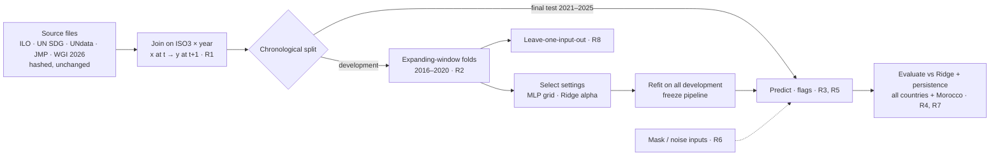

# IPR1 Proposal — Can Socioeconomic Indicators Improve Next-Year Governance Forecasts?
### A cross-country study with a Morocco case study
 
**Team:** Michael Hoefler, Colin Railey, Mercedes Rothrock  **Course:** AI380  **Date:** 25 November 2026
**Technique:** small feedforward neural network (multilayer perceptron, MLP), compared against Ridge regression and persistence baselines
 
---
 
## 1. Problem Definition
 
### 1.1 Problem statement
We ask whether a small neural network can predict next year's World Bank **Political Stability (PV)** and **Government Effectiveness (GE)** scores more accurately than two simple baselines. The network uses each country's current scores plus four socioeconomic indicators. We also measure how much accuracy drops when those indicators are missing or unreliable.
 
### 1.2 Stakeholder and need
**Intended users:** regional and country analysts, for example at NGOs, development agencies, or policy and security desks, who prepare country assessments. **Morocco** is the worked example of that use case throughout the proposal.
 
They need a reproducible answer to one question: *do widely available socioeconomic indicators tell us anything about next year's governance scores beyond what last year's score already says?* They also need to know whether that answer still holds when data is incomplete. The project supports analyst judgment. It **does not** issue operational alerts.
 
**What "stability" means here:** PV measures perceptions of destabilization and threats to political authority. GE measures perceptions of the quality of public services and policy. Both are **limited proxies** for governance stability. We predict their published 0–100 scores separately and do not combine them into an invented index. [5, 6]
 
### 1.3 Why test an AI approach?
- **Spreadsheet / persistence:** a spreadsheet can make the non-AI prediction "next year's score = this year's score." Governance changes slowly, so this baseline is hard to beat.
- **Ridge regression:** fits a constrained *linear* relationship between the same inputs and each outcome.
- **Neural network:** tests whether a small *nonlinear* relationship adds measurable value. For example, an inflation spike may matter more in a low-income country than in a high-income one.
The extra complexity is justified **only by evidence**. A result where a baseline wins is acceptable and useful.
 
### 1.4 Scope
| Included | Excluded |
|---|---|
| About 180 countries (final count set by the data audit, R1), one year ahead | Forecasts more than one year ahead; monthly labels created from annual scores |
| Two outcomes: WGI PV and GE (0–100 scores, 2026 vintage) | Predicting coups or other events; causal claims |
| Four UN-hosted inputs plus the current year's PV and GE | Other countries' data in the Morocco-only analysis; text or news data |
| Chronological validation; two baselines; missing-data and noise tests | Real-time deployment |
| Leave-one-input-out analysis; Morocco case study | Choosing features or settings using final-test errors |
 
### 1.5 Feasibility
- **Data:** four public annual series plus one WGI workbook (already obtained), joined on ISO3 country code and year. This gives about 3,200 development rows and about 900 test rows.
- **Compute:** `scikit-learn` MLP and Ridge models with fixed small search grids. Every fit takes seconds on a laptop.
- **Team:** three members with clear owners (§7). Most of the effort goes into checking data, comparisons, and conclusions, not into building a large application.
- **Fallback:** if the network is unstable, Ridge with the same pipeline is a complete result.
---
 
## 2. Related Work and Research Question
 
**Political-instability forecasting.** Goldstone et al. (2010) predict the onset of instability across countries using a small set of variables, including regime type. They report better than 80% accuracy with a two-year lead for worldwide cases from 1955–2003. *We reuse* their emphasis on a precise outcome and a parsimonious model. *We differ* because they classify discrete events using political variables, while we predict continuous WGI scores from socioeconomic inputs. Their accuracy therefore is not our benchmark. [1]
 
**Evidence against assuming a complex model will win.** Makridakis, Spiliotis & Assimakopoulos (2018) compare methods on 1,045 monthly series from the M3 forecasting competition. Statistical methods beat machine-learning methods on both accuracy measures at every horizon tested, at lower computational cost. Their setting is monthly and mostly univariate, so it does not prove our network will fail. *We adapt* their insistence on strong simple baselines and independent evaluation. This is why persistence and Ridge are required comparisons. [2]
 
**How to evaluate later observations.** Hyndman & Athanasopoulos describe persistence forecasts and evaluation with a rolling forecasting origin, where training uses only observations before each evaluated point. Their worked example shows that how well a model fits its training data is not the same as how well it forecasts. *We adapt* expanding training windows within the development years and reserve the latest years for one final test. [3]
 
**A maintained neural-network implementation.** The scikit-learn MLP documentation covers nonlinear regression, sensitivity to input scaling and random initialization, and L2 regularization. It recommends the L-BFGS optimizer for small datasets. These are implementation guidelines, not evidence of accuracy. *We reuse* that implementation with a small fixed grid of architectures, input scaling fitted on training data only, and repeated random seeds. Ridge provides the constrained alternative. [4, 7]
 
**Measurement limits.** The WGI documentation describes the indicators as composites built from perception data, each with a stated uncertainty. It reports that current and previous data versions correlate at about 0.99–1.00, which supports consistency across releases but does not mean the scores are measured perfectly. *We reuse* its outcome definitions, keep a single data version, and treat our predictions as estimates of *published* scores. [5, 6]
 
**Gap / research question.** These sources lead to a bounded study:
- *Does a small regularized neural network that uses current scores plus four socioeconomic indicators improve on Ridge and persistence for next-year PV and GE across countries?*
- *How much of any gain survives when inputs are missing or noisy?*
- *Which inputs contribute, and does the pooled model help for Morocco?*
The contribution is a controlled comparison and an honest explanation of success or failure. It is not a claim to discover what causes national stability.
 
---
 
## 3. Problem Formulation
 
**Type:** supervised regression with two outputs, run offline in Python.
**One example:** the input vector **x**(c, t) for country *c* in year *t*, paired with the target **y**(c, t+1) = [PV, GE] in the next year.
 
### 3.1 Inputs and targets
| Variable | Definition | Source |
|---|---|---|
| Youth unemployment | Ages 15–24, both sexes, % of youth labor force (modelled estimates) | ILO ILOEST [8] |
| Inflation | Annual CPI change, % (zero and negative values are valid) | UN SDG platform, `FP_CPI_TOTL_ZG` [9] |
| GDP per capita | PPP, constant 2021 international $ (log-transformed) | UNdata / WDI `NY.GDP.PCAP.PP.KD` [10] |
| Basic drinking water | % of population using at least basic services | WHO/UNICEF JMP [11] |
| PV(t), GE(t) | **Current-year** scores (0–100) | WGI 2026 workbook [6] |
| **Targets** PV(t+1), GE(t+1) | Next-year scores (0–100, not rescaled) | WGI 2026 workbook [6] |
 
**Why the current scores are inputs.** Persistence already uses PV(t) and GE(t). Giving the network and Ridge the same information makes the comparison fair. It also turns the research question into the one the stakeholder cares about: *do the socioeconomic indicators add information beyond last year's score?*
 
GDP and WGI are World Bank series. GDP is accessed through UNdata; being hosted by the UN does not mean the UN produced it. Extraction filters and the output schema are listed in Appendix B.
 
### 3.2 Data split (chronological; years are never shuffled)
| Use | Input years | Outcome years | Approx. rows |
|---|---|---|---|
| Development | 2002–2019 | 2003–2020 | about 180 countries × 18 years ≈ 3,200 |
| Reserved final test | 2020–2024 | 2021–2025 | about 180 × 5 ≈ 900 |
 
Input years start in **2002** because WGI has no 2001 release, and persistence needs the prior year's score.
 
**Validation:** expanding-window folds predicting each outcome year *v* ∈ {2016, …, 2020}. Each fold trains on outcome years 2003 through *v−1*. After selecting settings, we refit on all development data, then freeze the models and the preprocessing before computing any final-test error. [3, 12]
 
**Rows dropped or imputed:** rows missing a target or a current-year score are dropped and counted. Missing socioeconomic inputs are **imputed with training-fold medians** inside the pipeline. Imputed values are counted per country and per year, and no imputation is applied to the stored dataset.
 
### 3.3 Model, objective, and library mapping
- **Pipeline:** `make_pipeline(SimpleImputer(strategy="median"), StandardScaler(), MLPRegressor(...))`, fitted on `X_train` with shape (n, 6) and `Y_train` with shape (n, 2), target order `[pv, ge]`. `.predict(X)` returns two scores per row.
- **Ridge:** the same imputer and scaler, followed by `Ridge(alpha)`.
- **Training objective:** squared error over both outputs plus an L2 weight penalty (`alpha`).
- **Model selection:** minimize the mean MAE, weighted equally across the two outputs, the five validation years, and five seeds.
- **Reporting:** final MAE and RMSE are reported separately for PV and GE, for all countries and for Morocco.
### 3.4 Task context and assumptions
This is a static prediction system, not an agent acting on its environment, so a PEAS description does not apply.
 
- **Inputs:** one row of six values per country-year.
- **Outputs:** two predicted scores, plus flags for extrapolation and imputation.
- **Assumptions:**
  1. Relationships learned from earlier years may last long enough to test. They are not assumed to hold permanently.
  2. Countries are pooled under one shared model, with no country-specific terms.
  3. The study is a **retrospective** experiment on the currently published data version. Release delays and revisions mean it cannot recreate what was actually known at each historical date. [5, 8]
---
 
## 4. Requirements Specification
The full specification is in **[`docs/requirements.md`](requirements.md)**. These are proposed classroom thresholds, chosen before any results were seen. Failed requirements stay visible.
 
| ID | Type | Short name |
|---|---|---|
| R1 | Functional | Traceable cross-country lagged dataset |
| R2 | Reliability | Chronological / final-test isolation |
| R3 | Functional | Complete, labeled predictions (all countries + Morocco) |
| R4 | Performance | MAE ≥ 10% below both baselines |
| R5 | Robustness | Invalid-input handling and extrapolation flags |
| R6 | Robustness | Degradation under missing / noisy inputs |
| R7 | Reliability | Seed stability |
| R8 | Explanation | Leave-one-input-out contribution (development only) |
| R9 | Reliability | Reproducible by a second team member |
 
---
 
## 5. Technique Selection and Design
 
### 5.1 Chosen technique
We use a **small MLP**, with `tanh` activation, two linear outputs, and the L-BFGS optimizer. It is chosen to *test* whether nonlinear learning helps, not because we know it will be better. Ridge and persistence are the required comparisons. Pooling across countries gives the network enough rows to learn interactions that a single country's roughly 20 years could not support.
 
### 5.2 Alternatives considered
| Alternative | Why not selected |
|---|---|
| **HMM + Bayesian network** (the original pitch) | It needs the scores turned into discrete stability tiers, which throws away information analysts use. A missing-data-aware forward algorithm and structure learning add implementation risk for a three-person team on this schedule. We keep the pitch's *missing-data question* (R6) and drop the technique. |
| **Gradient-boosted trees** | A strong tabular baseline, but it adds a second large search space. It is a stretch goal if time remains. |
| **Morocco-only model** | Only about 20 annual pairs, which is too few for a nonlinear model. Morocco is kept as a case study within the pooled model. |
 
**(planned)** labels: Ridge, temporal cross-validation, and ablation analysis may come before class coverage. The fallback for each is the standard `scikit-learn` implementation used as documented.
 
### 5.3 Architecture / data flow

_If the proposal is exported to PDF, this diagram is replaced with a rendered image._
 
### 5.4 Prespecified choices
| Component | Choice |
|---|---|
| Network | `hidden_layer_sizes` ∈ {(8,), (16,)}; `activation='tanh'`; `solver='lbfgs'`; `alpha` ∈ {0.1, 1, 10} |
| Optimization | `max_iter=5000`; `tol=1e-6`; `early_stopping=False`; seeds 0–4; convergence warnings recorded |
| Selection | Lowest mean validation MAE. Ties within 1e-6 go to the smaller network, then the larger alpha. |
| Ridge | `alpha` ∈ {0.1, 1, 10}, using the same folds and selection rule |
| Persistence | ŷ(t+1) = y(t). No fitting. |
| Libraries | pandas, NumPy, scikit-learn, pytest + Hypothesis, matplotlib; versions pinned |
 
---
 
## 6. Verification and Validation Plan
 
### 6.1 Verification — did we build it right?
- **V1 (R1):** independent source audit of three sample pairs for Morocco plus two other countries (2002→2003, 2015→2016, 2024→2025). Automated checks of key uniqueness, units, and that outcome year = input year + 1.
- **V2 (R2):** saved fold masks; the imputer and scaler are fitted only on training rows. *Tamper test:* changing final-test labels must not change any fitted transformation, selected setting, or model parameter.
- **V3 (R3):** checks of output shape, finiteness, and the order of the PV and GE columns. *Metric fixture:* actual values [[40, 70], [60, 80]] and predictions [[43, 72], [56, 74]] must give MAEs of 3.5 and 4.0, RMSEs of √12.5 and √20, and a mean MAE of 3.75.
- **V4 (R5):** unit and Hypothesis tests. The system must reject infinite values, GDP ≤ 0, and percentages outside 0–100. It must accept negative inflation and boundary percentages, and it must flag out-of-range values without dropping them.
- **V5 (R6 harness):** property test showing that masking inputs changes only the masked cells, and that the imputer then uses training medians, never test statistics.
- **V6 (pipeline sanity):** generate synthetic data with a known nonlinear signal, y(t+1) = y(t) + f(x). The MLP must beat Ridge on it, and with no signal (pure noise) neither model may beat persistence by more than chance. This confirms the pipeline can find a signal that exists.
- **V7 (R9):** a second team member re-runs everything from the README and must match predictions within 1e-6.
### 6.2 Validation — did we build the right thing?
| Exp. | Req. | What | Uncertainty reported |
|---|---|---|---|
| E1 | R4 | Final-test MAE and RMSE for PV and GE: MLP vs. Ridge vs. persistence. Evaluated once, after freezing. | 95% bootstrap CI that resamples whole countries (1,000 resamples); *paired* for differences between models |
| E2 | R7 | Five final fits (seeds 0–4) | Mean, sample SD, and range. The best test seed is never selected. |
| E3 | R6 | 30% of indicator values masked at random, and ±10% relative noise on inputs, over 20 seeds. Run for MLP and Ridge. | Mean ± SD |
| E4 | R8 | Leave-one-input-out within development: 4 variants × 5 folds × 5 seeds | MAE change by target, year, and seed, including sign changes |
| E5 | — | **Morocco case study:** its five test-year predictions and errors for each model, plotted against published scores | Descriptive only (5 points, no significance claims) |
 
**Fit budget:** for the MLP, 6 configurations × 5 folds × 5 seeds = 150 selection fits, plus 100 ablation fits, plus 5 final fits. Ridge needs 15 validation fits plus 1 final fit. More fits do **not** add independent observations. Seed variation measures sensitivity to the optimizer, not uncertainty about future events.
 
**Reporting rule:** every requirement is reported as met or unmet, with evidence. Per-year errors are shown so that one unusual year (for example, a post-COVID shift) is visible.
 
---
 
## 7. Plan, Roles, and Risks
 
### 7.1 Schedule and responsibilities
These dates carry forward IPR2 on **7 December** and the presentation on **11 December**.
 
| Dates (2026) | Deliverable | Lead |
|---|---|---|
| 25–27 Nov | Source files, hashes, ISO3 crosswalk, joined panel, source audit (V1) | **Data lead** _[Name]_ |
| 28–30 Nov | Persistence, Ridge, fold masks, metric fixtures, isolation tests (V2–V5) | **Evaluation lead** _[Name]_ |
| 1–3 Dec | MLP selection, seed study, ablation, synthetic sanity check (V6) | **Model lead** _[Name]_ |
| 4–6 Dec | Review requirements, freeze settings, run the final test once, robustness runs, inspect failures | Whole team |
| 7 Dec | IPR2: progress evidence, limitations, logged changes | Whole team |
| 8–11 Dec | Morocco case study, report and slides, independent rerun (V7), rehearsal | Evaluation lead (report) + whole team |
 
**Shared integration tasks:** agree the data schema on day 1, review model-selection records, reconcile the requirement status table, and check that every claim in the report matches saved evidence.
 
### 7.2 If time runs short, simplify in this order
1. Gradient-boosted trees (stretch goal).
2. Extra visualizations.
3. The noise half of R6. Keep the masking half.
4. Reduce the ablation to one seed. Record a dated change to R8 *before* the final test.
**Never cut:** the data audit, temporal separation, both baselines, all final-test years, and honest error reporting.
 
### 7.3 Top three risks
| Risk | Mitigation |
|---|---|
| **Persistence is hard to beat.** Scores change slowly, so the indicators may add little. | Accept a negative result as valid. Report the size of every model's gain or loss against persistence. Ridge is the fallback result. |
| **Misaligned or patchy data.** Wrong units, mixed data versions, or coverage gaps that are worst in fragile countries could create fake predictive value. | Keep source files and hashes, check lags independently, fit preprocessing within each fold, count imputations per country, and test missingness directly (R6). |
| **Unstable estimates and weak explanations.** Initialization and correlated trends could reverse feature rankings. | Report all seeds, convergence warnings, and extrapolation flags. Label ablation results as exploratory. Make no causal claims. |
 
### 7.4 Elevator Pitch feedback and scope changes
- **Instructor feedback and decision:** Our initial idea was disapproved, and then we conducted an additional meeting for the same project idea. It was approved, but our instructors recommended we look into another idea since our original one may have proven too difficult or time-consuming to complete.
- **Student-selected changes since the pitch** (these are *not* evidence of instructor approval):
  1. **Technique changed from HMM + Bayesian network to a small neural network with Ridge and persistence baselines.** The reasons are lower implementation risk and keeping continuous scores (§5.2).
  2. **Outputs changed from discrete stability tiers to next-year PV and GE scores.**
  3. **Scope is cross-country, with Morocco as a case study.**
  4. **The pitch's "missing / unreliable indicators" goal is kept as R6.**
- _[For each change the instructor requests, record the change, the section affected, and the evidence it was completed.]_
---
 
## References
[1] Goldstone, J. A., et al. (2010). A Global Model for Forecasting Political Instability. *American Journal of Political Science*, 54(1), 190–208. https://doi.org/10.1111/j.1540-5907.2009.00426.x
[2] Makridakis, S., Spiliotis, E., & Assimakopoulos, V. (2018). Statistical and Machine Learning forecasting methods: Concerns and ways forward. *PLOS ONE*, 13(3), e0194889.
[3] Hyndman, R. J., & Athanasopoulos, G. *Forecasting: Principles and Practice*, 3rd ed., Ch. 5. https://otexts.com/fpp3/toolbox.html
[4] scikit-learn developers. MLPRegressor documentation. Accessed 24 Nov 2026.
[5] World Bank. Worldwide Governance Indicators: Frequently Asked Questions. Accessed 24 Nov 2026.
[6] World Bank (2026). Worldwide Governance Indicators, 2026 update. Workbook `wgidataset_with_sourcedata-2026.xlsx` (0–100 governance scores).
[7] scikit-learn developers. Ridge documentation. Accessed 24 Nov 2026.
[8] International Labour Organization. ILO modelled estimates (ILOEST): youth unemployment, both sexes, ages 15–24.
[9] UN Statistics Division. Global SDG Indicators Data Platform, series `FP_CPI_TOTL_ZG`.
[10] UN Statistics Division. UNdata, WDI: `NY.GDP.PCAP.PP.KD`.
[11] WHO/UNICEF Joint Monitoring Programme. Household drinking-water data, at least basic services.
[12] scikit-learn developers. TimeSeriesSplit documentation (we store explicit year-based fold masks).
 
---
 
## Appendix B. Source extraction and data dictionary
Keep downloaded files unchanged, and record access dates and SHA-256 hashes. Use an explicit **country-name → ISO3 crosswalk**; do not assume every publisher uses the same country field.
 
| Series | Extraction notes |
|---|---|
| ILO youth unemployment | Dataset `UNE_2EAP_SEX_AGE_RT_A`; `SEX_T`; `AGE_YTHADULT_Y15-24`; modelled estimates only |
| UN CPI inflation | `FP_CPI_TOTL_ZG`, national level. Keep zero and negative values; do not substitute CPI index levels. |
| GDP per capita | `NY.GDP.PCAP.PP.KD`. Do not mix in current-dollar GDP, total GDP, or GDP growth. |
| JMP basic water | `wat` sheet, `wat_basal_t` (national total). Do not substitute "safely managed" or formatted ">99" strings. |
| WGI | `pv` and `ge` sheets, governance score (0–100). The latent-estimate column is a different measure. Keep the uncertainty fields for context. |
| **Output schema** | `iso3, input_year, outcome_year, youth_unemp_pct, inflation_pct, gdp_pc_ppp_2021, basic_water_pct, pv_t, ge_t, pv_t1, ge_t1`. Provenance is kept in a separate manifest. |
 
## Appendix C. Team and instructor records to complete
| Record | Entry |
|---|---|
| Team members and role owners | _[3 names; fill each [Name] in §7.1]_ |
| Elevator Pitch | 23 November 2026 - all members present |
| Instructor feedback and scope decision | We were told to evaluate our initial idea further, and upon that evaluation we decided to pivot to this project instead. |
| IPR1 deadline | Officially due at 2359 on 23 November 2026, however LTC Hutchison granted an extension for us to complete it by the end of Wednesday, 25 Novemeber 2026 due to switching our proposal at the last minute. |
| DAAW | Please see docs/DAAW.pdf for the full DAAW for IPR1 |
| Repository / submission | _[Repo URL, commit, `ipr1` tag URL, Canvas upload confirmation]_ |
 
